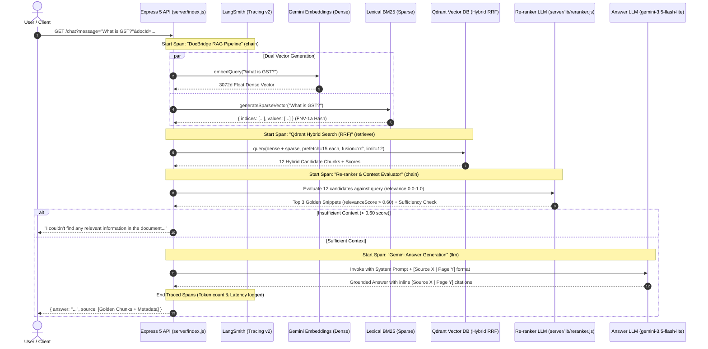

<div align="center">

# 🌉 DocBridge 2.0

### Production-Grade, Citation-Backed Document Intelligence Powered by Hybrid Dense + Sparse RAG, LangSmith Observability & DeepEval CI/CD Quality Gates

[](https://github.com/Adityakumar626/docbridge-2.0)
[](https://nextjs.org/)
[](https://react.dev/)
[](https://www.docker.com/)
[](https://qdrant.tech/)
[](https://smith.langchain.com)
[](https://confident-ai.com)

</div>

---

## 📌 Executive Overview

**DocBridge 2.0** is an enterprise-grade document intelligence platform engineered to eliminate hallucinations when analyzing complex technical documentation, legal contracts, regulatory filings, and research papers.

Most naive RAG implementations suffer from fundamental flaws:
1. **Keyword Blindness:** Pure dense vector search frequently misses exact alphanumeric identifiers, section codes, abbreviations, and part numbers.
2. **Context Dilution:** Naive top-k retrieval injects irrelevant context into the LLM prompt, increasing latency and confusing the model.
3. **Black-Box Failures:** Teams cannot trace whether errors originated in vector search, re-ranking, token context windows, or model generation.
4. **Unverified Claims:** Answers lack exact line-by-line source grounding, leading to unverified hallucinations.

**DocBridge 2.0 solves this systematically:**
- **Hybrid Retrieval:** Blends **3072-dimensional Gemini dense embeddings** with **custom FNV-1a BM25 lexical sparse vectors** fused via native **Reciprocal Rank Fusion (RRF)** in Qdrant.
- **Listwise Re-Ranking:** Evaluates candidate chunks with objective scoring (`relevanceScore > 0.60`), discarding irrelevant boilerplate.
- **Interactive Citation Badges:** Every claim is tied inline to `[Source X | Page Y]` tokens that open a slide-out verification drawer displaying the exact PDF excerpt.
- **Production Observability:** Full end-to-end distributed tracing via **LangSmith** tracking latency, token usage, and cost per request.
- **Automated Quality Testing:** Automated CI/CD quality gate using **DeepEval** that verifies Faithfulness, Answer Relevancy, and Citation fidelity on every git commit.

---

<a id="architecture"></a>
## 🏗️ System Architecture & Data Flow

### 1. High-Level Infrastructure Topology
```
                                      [ Client Browser ]
                                              │
                                  ┌───────────▼───────────┐
                                  │  Next.js 16 Frontend  │ (Port 3000)
                                  │ (React 19, Clerk, UI) │
                                  └───────────┬───────────┘
                                              │ HTTP Requests
                                  ┌───────────▼───────────┐
                                  │   Express 5 REST API  │ (Port 8000)
                                  │   (LangSmith Traced)  │
                                  └─────┬───────────┬─────┘
                    Uploads File (PDF)  │           │ Queries
                                        ▼           ▼
            ┌─────────────────────────────┐       ┌─────────────────────────────┐
            │     Valkey / Redis 8        │       │    Qdrant Vector Database   │
            │   (file-upload-queue:6379)  │       │  Collection: 'pdf-docs':6333│
            └──────────────┬──────────────┘       │  - Dense: 3072d Cosine      │
                           │ Queue Consumption    │  - Sparse: FNV-1a BM25      │
                           ▼                      └──────────────▲──────────────┘
            ┌─────────────────────────────┐                      │
            │     BullMQ Worker (Node)    ├──────────────────────┘
            │  - PDFLoader (LangChain)    │ Batch Upserts (wait=true)
            │  - Chunking (500/50 split)  │ Shared Volume: /app/uploads
            │  - Batched Gemini Vectors   │
            │  - LangSmith Job Tracing    │
            └─────────────────────────────┘
```

### 2. End-to-End RAG Query Lifecycle (Sequence Flow)


---

<a id="key-features"></a>
## ✨ Core Technical Features

### 1. Dual-Vector Hybrid Retrieval (RRF)
Queries are executed simultaneously against two vector spaces:
- **Dense Vector:** 3072-dimensional semantic embedding via `gemini-embedding-001`.
- **Sparse Vector:** Lexical token frequencies weighted by BM25 ($k_1 = 1.2$) and indexed using 32-bit unsigned FNV-1a hashing in [server/lib/bm25.js](server/lib/bm25.js).
- **Fusion:** Native Qdrant Reciprocal Rank Fusion (`fusion: 'rrf'`) retrieves a candidate pool of 12 balanced passages, completely eliminating keyword blindness.

### 2. Listwise Context Re-Ranking & Corrective Guardrails (CRAG)
Rather than passing all 12 passages directly to the generation model, [server/lib/reranker.js](server/lib/reranker.js) evaluates candidates:
- Scores each passage on a `0.0 to 1.0` relevance scale with explicit justification.
- Filters candidates with threshold `> 0.60` down to the top 3 **golden snippets**.
- Assesses overall context sufficiency (`hasSufficientContext`). If information is absent from the document, DocBridge returns: *"I couldn't find any relevant information in the document to answer your question."*

### 3. Interactive Page-Level Citation Badges
The frontend in [client/app/components/chat.tsx](client/app/components/chat.tsx) parses bracketed citation tokens:
- Formats inline interactive pills: `Source 1 • P.7`.
- Clicking any pill toggles an excerpt modal showing the exact chunk text, page number, document filename, and metadata without cluttering the main response.

### 4. Distributed Observability via LangSmith
Both [server/index.js](server/index.js) and [server/worker.js](server/worker.js) are instrumented with LangSmith’s `traceable`:
- **Trace Hierarchy:** `DocBridge RAG Pipeline` ➔ `Qdrant Hybrid Search (RRF)` ➔ `Re-ranker & Context Evaluator` ➔ `Gemini Answer Generation`.
- **Token & Cost Profiling:** Automatically logs prompt tokens, completion tokens, duration, and cost per query.
- **Worker Tracing:** Traces background PDF parsing, chunk counts, batched embeddings generation, and Qdrant roundtrips.

### 5. Automated CI/CD Quality Gate via DeepEval
A complete testing framework in [evals/](evals/) verifies system accuracy before shipping code:
- **FaithfulnessMetric:** Evaluates whether answers contain hallucinations.
- **AnswerRelevancyMetric:** Checks if answers address the user's prompt without topic drift.
- **Citation Adherence (`G-Eval`):** Evaluates whether inline citations strictly match the context source numbers.
- **GitHub Actions Integration:** [.github/workflows/evals.yml](.github/workflows/evals.yml) runs on every push and pull request.

---

## 📂 Repository File-by-File Tour

| File Path | Component | Architectural Purpose & Responsibility |
| :--- | :--- | :--- |
| [docker-compose.yml](docker-compose.yml) | Orchestration | 5-container production stack (Redis, Qdrant, Express API, Worker, Next.js). |
| [.env.example](.env.example) | Configuration | Production environment variable blueprint for Gemini, Clerk, and LangSmith. |
| [.github/workflows/evals.yml](.github/workflows/evals.yml) | CI/CD Quality Gate | Automated GitHub Actions workflow testing RAG Faithfulness & Relevancy via DeepEval. |
| [server/index.js](server/index.js) | Backend API | Express 5 API handling `/chat` & `/upload/pdf`, wrapped in LangSmith `traceable` spans. |
| [server/worker.js](server/worker.js) | Queue Worker | BullMQ worker: parses PDFs, chunks text (500/50), generates batched dense + sparse embeddings. |
| [server/lib/bm25.js](server/lib/bm25.js) | Sparse Algorithm | Custom FNV-1a hashing & BM25 weighting generating sparse vector indices for Qdrant. |
| [server/lib/reranker.js](server/lib/reranker.js) | Context Re-ranker | LLM-as-a-judge listwise scoring (>0.60 threshold), filtering candidates down to golden snippets. |
| [client/proxy.ts](client/proxy.ts) | Security & Auth | Next.js Clerk middleware enforcing protected `/dashboard` routes and redirect handling. |
| [client/app/page.tsx](client/app/page.tsx) | Landing Page | Modern landing page featuring animated beam RAG flow, dark/light theme, and Clerk auth. |
| [client/app/dashboard/page.tsx](client/app/dashboard/page.tsx) | Dashboard | Authenticated workspace hosting PDF uploader, document state, and citation chat view. |
| [client/app/components/chat.tsx](client/app/components/chat.tsx) | Chat & Citations | Interactive chat interface parsing `[Source X \| Page Y]` into interactive preview badges. |
| [client/app/components/fileUpload.tsx](client/app/components/fileUpload.tsx) | PDF Uploader | Drag-and-drop PDF ingestion component with upload state, validation, and active doc context. |
| [evals/test_docbridge.py](evals/test_docbridge.py) | Pytest Evals | DeepEval automated test suite evaluating Faithfulness, Answer Relevancy, and G-Eval citations. |
| [evals/run_evals.py](evals/run_evals.py) | CLI Test Runner | Standalone interactive CLI runner for evaluating arbitrary queries against running API. |
| [evals/pyproject.toml](evals/pyproject.toml) | Python Workspace | `uv` package definition configured with `package = false` and required evaluation libraries. |
| [evals/requirements.txt](evals/requirements.txt) | Python Deps | Pip-compatible dependency manifest for DeepEval, requests, and google-genai. |

---

## 🛠️ Complete Tech Stack

| Domain | Technology | Version | Purpose |
| :--- | :--- | :--- | :--- |
| **Frontend Framework** | `Next.js` | `16.3.5` | React Server Components, App Router, Client Dashboard |
| **UI Library** | `React` | `19.2.8` | Component architecture & state management |
| **Styling** | `Tailwind CSS` | `4.x` | Modern utility-first styles & dark mode tokens |
| **Authentication** | `Clerk` | `7.9.2` | User sign-in, sign-up, user profiles, session guards |
| **Backend Framework** | `Express` | `5.2.1` | REST API, streaming endpoints, file uploads |
| **Runtime** | `Node.js` | `20-alpine` | High-performance asynchronous execution |
| **Vector Database** | `Qdrant` | `v1.19.0` | Dual-vector storage: 3072d dense + sparse BM25 with RRF |
| **Message Broker** | `Valkey / Redis`| `8-alpine` | In-memory job queue for asynchronous PDF processing |
| **Job Queue** | `BullMQ` | `6.3.6` | Task dispatch, worker concurrency, and job retries |
| **Embeddings** | `Gemini Embedding`| `001` | High-dimensional dense semantic vectors (3072 dimensions) |
| **Sparse Algorithm** | `Custom BM25` | `Native JS` | FNV-1a hash dictionary + term frequency saturation |
| **Inference LLM** | `Gemini Flash Lite`| `3.5 / 3.1` | Low-latency response generation with strict grounding |
| **Observability** | `LangSmith` | `0.3.x` | Full distributed tracing, run trees, and token analytics |
| **Evaluation** | `DeepEval` | `4.x` | LLM-as-a-judge test runner for automated quality testing |
| **Python Tooling** | `uv` | `Latest` | Ultra-fast Python package and virtualenv manager |
| **Orchestration** | `Docker Compose`| `v2` | Multi-container networking, healthchecks, and volumes |

---

<a id="quickstart"></a>
## 🚀 Quickstart with Docker Compose

Run the entire 5-container architecture with a single command.

### 1. Clone the Repository
```bash
git clone https://github.com/Adityakumar626/docbridge-2.0.git
cd docbridge-2.0
```

### 2. Configure Environment Variables
Copy the template and supply your API keys:
```bash
cp .env.example .env
```

Edit `.env`:
```env
# Google Gemini API Key (Required for Embeddings & Chat)
GOOGLE_API_KEY=your_gemini_api_key_here

# Clerk Authentication (Required for Web Interface)
NEXT_PUBLIC_CLERK_PUBLISHABLE_KEY=pk_test_your_clerk_key
CLERK_SECRET_KEY=sk_test_your_clerk_secret_key

# LangSmith Observability (Required for Tracing)
LANGCHAIN_TRACING_V2="true"
LANGCHAIN_ENDPOINT="https://api.smith.langchain.com"
LANGCHAIN_API_KEY="lsv2_pt_your_langsmith_key"
LANGCHAIN_PROJECT="docbridge-production"
```

### 3. Build & Launch Containers
```bash
docker compose up -d --build
```

### 4. Verify Active Services
| Service | URL | Notes |
| :--- | :--- | :--- |
| **DocBridge Web App** | [http://localhost:3000](http://localhost:3000) | Full UI with Clerk authentication |
| **Express API** | [http://localhost:8000](http://localhost:8000) | Health endpoint: `GET /` |
| **Qdrant Vector Dashboard**| [http://localhost:6333/dashboard](http://localhost:6333/dashboard) | Inspect collections, vectors, and payloads |

---

<a id="local-setup"></a>
## 💻 Local Development Setup

If you prefer running services directly on your host machine for development:

### 1. Start Infrastructure (Databases)
```bash
docker compose up -d redis qdrant
```

### 2. Start the Backend API & Background Worker
```bash
cd server
npm install

# Terminal 1: Express REST API (port 8000)
npm run dev

# Terminal 2: BullMQ Background Worker
npm run dev:worker
```

### 3. Start the Next.js Client
```bash
cd client
npm install
npm run dev
```
Open [http://localhost:3000](http://localhost:3000) in your browser.

---

## 🔬 Observability & Tracing with LangSmith

LangSmith is configured automatically via environment variables.

### What is Traced:
1. **`DocBridge RAG Pipeline` (Chain):** Measures total request duration and links child spans.
2. **`Qdrant Hybrid Search (RRF)` (Retriever):** Displays dense vector length, sparse indices, filters, and all 12 candidate snippets with fusion scores.
3. **`Re-ranker & Context Evaluator` (Chain):** Displays listwise scoring rationale and the selection of golden context.
4. **`ChatGoogleGenerativeAI` (LLM):** Tracks model name, prompts, token counts, and cost in USD.
5. **`BullMQ PDF Ingestion Pipeline` (Chain):** Traces background worker document parsing, chunking, and Qdrant upserts.

### Viewing Runs:
Visit **[smith.langchain.com](https://smith.langchain.com)** ➔ Click **Projects** ➔ Select **`docbridge-production`**.

---

## 🧪 Automated Testing with DeepEval

The `evals/` directory contains an evaluation test suite powered by [DeepEval](https://github.com/confident-ai/deepeval).

### The Evaluation Metrics:
- **Faithfulness (`FaithfulnessMetric`):** Validates that all factual claims in the answer can be logically inferred from the retrieved chunks. Catches hallucinations.
- **Answer Relevancy (`AnswerRelevancyMetric`):** Uses reverse-question generation to ensure the answer addresses the prompt without extraneous fluff.
- **Citation Adherence (`GEval`):** Evaluates whether claims are properly cited using `[Source X | Page Y]` matching the context.

### Setup & Execution:
```bash
cd evals

# 1. Install dependencies using uv:
uv venv
source .venv/bin/activate
uv pip install -r requirements.txt

# 2. Configure judge model:
uv run deepeval set-gemini --model="gemini-3.5-flash-lite"

# 3. Option A: Run interactive single-query evaluation:
uv run python run_evals.py "What is GST and what are its main features?"

# 4. Option B: Run automated pytest quality gate:
uv run deepeval test run test_docbridge.py
```

### Sample Evaluation Output:
```
📊 Evaluation Results:
------------------------------------------------------------
✅ PASS | Faithfulness (No Hallucinations): 1.00 / 1.00
       Reason: The actual output is completely faithful to the retrieval context with no contradictions found.
✅ PASS | Answer Relevancy: 1.00 / 1.00
       Reason: The actual output directly and accurately addresses both parts of the input.
✅ PASS | Citation Adherence: 1.00 / 1.00
       Reason: The output strictly adheres to [Source X | Page Y] format and matches the provided context.
------------------------------------------------------------
```

---

<a id="api-reference"></a>
## 📡 API Reference

### 1. Ingest PDF Document
`POST /upload/pdf`
- **Request:** `multipart/form-data` with file field `pdf`.
- **Response (`200 OK`):**
```json
{
  "message": "uploaded",
  "docId": "536fcdbb-88b1-403e-98c5-ebb5a70fac51",
  "filename": "Basics_of_GST.pdf"
}
```

### 2. Grounded Chat Query
`GET /chat?message=<query>&docId=<optional-doc-id>`
- **Query Parameters:**
  - `message` (required): Natural language question.
  - `docId` (optional): Filter retrieval strictly to this document ID.
- **Response (`200 OK`):**
```json
{
  "answer": "GST is a single indirect tax for the whole nation [Source 1 | Page 7].",
  "source": [
    {
      "pageContent": "GST is one indirect tax for the whole nation, which will make India one unified common market...",
      "metadata": {
        "pageNumber": 7,
        "filename": "Basics_of_GST.pdf",
        "docId": "536fcdbb-88b1-403e-98c5-ebb5a70fac51",
        "chunkIndex": 40
      },
      "score": 0.2916667,
      "relevanceScore": 0.95,
      "rerankReason": "Directly defines GST as an indirect tax for the nation."
    }
  ]
}
```

### 3. Health Check
`GET /`
- **Response (`200 OK`):**
```json
{
  "status": "DocBridge 2.0 API is healthy"
}
```

---

## 🔒 Production Best Practices & Hardening

- **Payload Character Batching:** PDF text embeddings in `worker.js` are batched in groups of 5 (`BATCH_SIZE = 5`) to prevent Gemini API payload limit truncations.
- **Strict Grounding Prompts:** LLM instructions explicitly prohibit guessing and require inline citations formatted as `[Source X | Page Y]`.
- **Resilient Model Failover:** Generation uses `gemini-3.5-flash-lite` as primary with automatic failover to `gemini-3.1-flash-lite` and `maxRetries: 1` to prevent 4-minute retry hangs.
- **Namespaced Vector Isolation:** Qdrant points store `metadata.docId` allowing fast exact-match filtering per document.
- **Security & Secret Guards:** Docker containers run non-root wherever applicable; `.dockerignore` and `.gitignore` guard API secrets from repository leakage.

---

<div align="center">
  <sub>Built with ❤️ by <a href="https://github.com/Adityakumar626">Aditya Kumar</a></sub>
</div>
